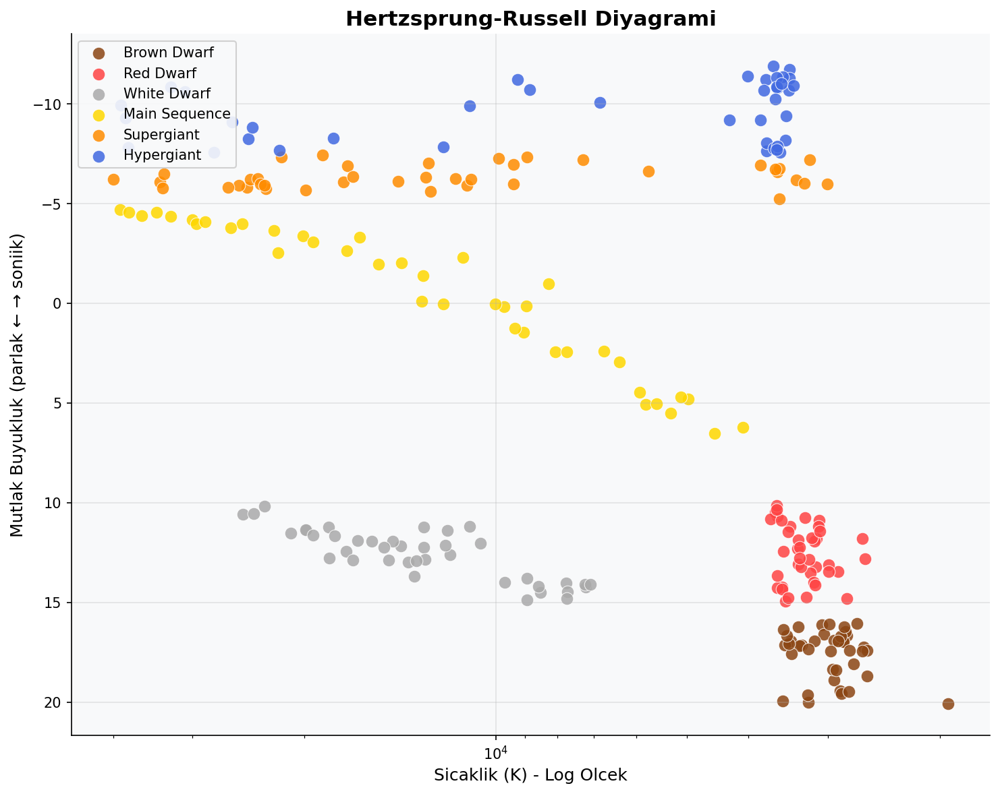

# Star Type Classification

Compare K-Nearest Neighbors, Decision Tree, and Random Forest classifiers on a small stellar dataset.

The notebook explores 240 observations in `Stars.csv`, encodes categorical attributes, and compares models using training-set cross-validation and a stratified holdout.

## Key Features

- Class distributions, physical-feature plots, and a Hertzsprung–Russell diagram.
- Color normalization and categorical encoding.
- Training-only cross-validation for KNN and tree parameter selection.
- Training-fitted scaling, holdout confusion matrices, feature importance, and learning curves.

## Tech Stack

Python, Jupyter, pandas, NumPy, Matplotlib, Seaborn, and scikit-learn. See [requirements.txt](requirements.txt).

## Architecture & Project Structure

```text
.
├── Veri_Madenciligi_Proje.ipynb  # EDA, preprocessing, model selection, evaluation
├── Stars.csv                   # 240 labeled observations
├── Outputs/                    # Historical plots; regenerated by the notebook
├── tests/                      # Holdout-isolation regression test
├── requirements.txt
└── LICENSE
```

Features are `Temperature`, `L`, `R`, `A_M`, normalized color, and spectral class. The target mapping follows the notebook:

| Label | Star type |
|---|---|
| 0 | Brown Dwarf |
| 1 | Red Dwarf |
| 2 | White Dwarf |
| 3 | Main Sequence |
| 4 | Supergiant |
| 5 | Hypergiant |

The split reserves 20% for final testing with seed 42. Model-selection CV and learning curves use only the remaining training rows. CV scores after parameter selection are descriptive and are not nested-CV estimates. The small dataset limits claims about performance on other stellar populations.

## Getting Started

Use Python 3.11 and an isolated environment:

```bash
git clone https://github.com/MustafArikan/star-type-classification.git
cd star-type-classification
python -m venv .venv
```

Activate with `source .venv/bin/activate` on Linux/macOS or `.venv\Scripts\Activate.ps1` in PowerShell.

```bash
python -m pip install -r requirements.txt
python -m pip install notebook
```

## Configuration

There are no required environment variables. Start from the repository root; the notebook reads `Stars.csv` and writes plots to `Outputs/`. Seeds, CV folds, and search ranges are defined in its modeling cells.

## Usage

```bash
jupyter notebook Veri_Madenciligi_Proje.ipynb
```

Run all cells in sequence. Plot files are overwritten on reruns. Committed images are historical artifacts and should not be treated as measurements of a changed experiment until regenerated.



## Testing

```bash
python -m unittest discover -s tests
```

The regression test executes the notebook's setup and selection cells and rejects any cross-validation call containing held-out rows. Full notebook execution additionally exercises plotting and the real CV searches.

## Development & Quality

Use `python -m pip check` after installation. Keep the holdout isolated when changing model selection. Do not publish prior charts as results of new code. No deployment or hosted inference service is provided.

## Roadmap

- Add dataset provenance and a reproducible dependency lock.
- Use nested cross-validation for model-family comparisons.
- Test categorical preprocessing on unseen values in an inference-oriented pipeline.

## Contributing

Include the split strategy, random seed, package versions, and validation results with modeling changes. Run the holdout regression test and regenerate affected plots before presenting new metrics.

## License

Code is distributed under the [MIT License](LICENSE). Verify dataset redistribution terms separately.

## Author

[Mustafa Arıkan](https://github.com/MustafArikan)
